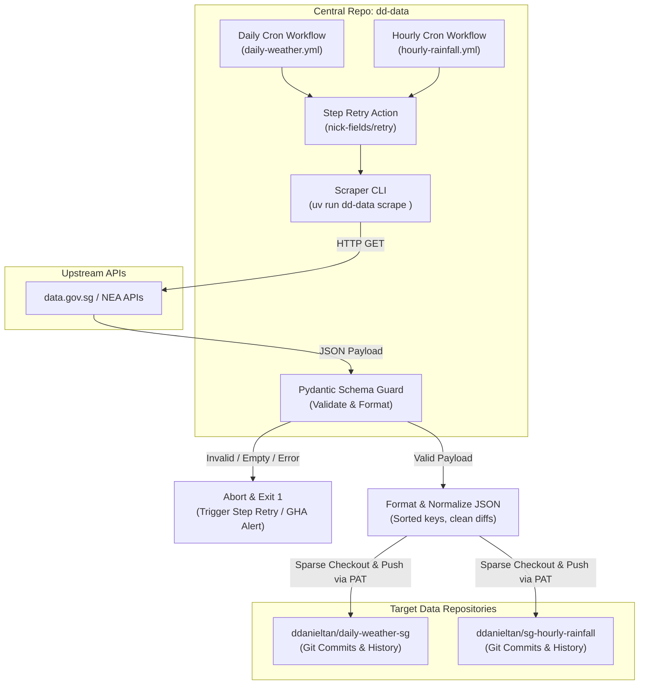

# Specification: dd-data (Centralized Git-Scraping Engine)

A centralized Git-Scraping repository named `dd-data` that decouples scraping logic, scheduling, and validation guards from individual data repositories (such as `ddanieltan/daily-weather-sg` and `ddanieltan/sg-hourly-rainfall`).

---

## 1. Objectives & Principles

1. **Centralized Codebase**: All scraping scripts, dependencies, Pydantic schemas, and GitHub Actions cron schedules live in `dd-data`.
2. **Decoupled Data Storage**: Target data repositories remain pure data stores containing git commit history and data files.
3. **Strict Data Integrity**: Every fetched payload must satisfy strict Pydantic models. Malformed, truncated, empty, or HTTP error payloads (e.g. `{"code": 500}`) abort execution with non-zero exit codes to prevent committing corrupt data into git history.
4. **Transient Resilience**: GitHub Actions workflows utilize step retries (`nick-fields/retry`) to absorb transient network drops, rate limits, or momentary upstream hiccups before failing fast.
5. **No Dirty Diffs**: Payloads are consistently normalized (sorted keys, stable 2-space indentation, trailing newlines) so git diffs only reflect genuine data changes. No empty commits are made when data hasn't changed.

---

## 2. Architecture & Data Flow



---

## 3. Directory Layout

```text
dd-data/
├── .github/
│   └── workflows/
│       ├── scrape-daily-weather.yml
│       └── scrape-hourly-rainfall.yml
├── src/
│   └── dd_data/
│       ├── __init__.py
│       ├── cli.py
│       ├── core/
│       │   ├── __init__.py
│       │   ├── base.py       # Scraper base class & registry
│       │   ├── git.py        # Safe Git diff checking & committing
│       │   └── logger.py     # Clean structured console logging
│       └── scrapers/
│           ├── __init__.py
│           ├── daily_weather.py
│           └── hourly_rainfall.py
├── tests/
│   ├── __init__.py
│   └── test_schemas.py
├── pyproject.toml
├── README.md
└── SPEC.md
```

---

## 4. Authentication & Target Repository Updates

- The runner authenticates to GitHub using a Fine-Grained Personal Access Token (PAT) stored as secret `TARGET_REPO_PAT` in `dd-data`.
- The token requires `Contents: Read and write` permission for the target repositories:
  - `ddanieltan/daily-weather-sg`
  - `ddanieltan/sg-hourly-rainfall`
- In CI, `actions/checkout` checks out the target repository into a subdirectory (e.g. `./target-repo`).
- After running the scraper and validating the schema, the CLI writes to `./target-repo/<target_path>`.
- `git status --porcelain` is inspected:
  - If changes exist: `git add`, `git commit -m "Automated update: <timestamp>"`, and `git push`.
  - If no changes exist: exits cleanly with no commit.

---

## 5. Failure Handling & Retries

1. **Schema Rejection**: Any missing required fields, non-JSON response, or HTTP status >= 400 immediately raises an exception and exits non-zero.
2. **CI Step Retries**: Workflow steps use `nick-fields/retry@v3` with `max_attempts: 3` and `retry_on: error` to handle intermittent connection drops without manual intervention.
3. **Hard Fail Alerting**: If all 3 attempts fail, the workflow run fails fast and GitHub sends standard notifications for visibility.
